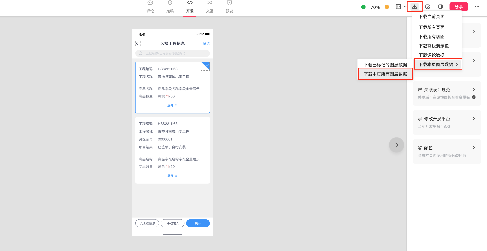

# design-analyzer

从**摹客设计稿 JSON** 生成规格文档。

## 怎么用

1. **导出物料**：在摹客打开设计稿，点击右上角下载按钮 →「下载本页图层数据」→「下载本页所有图层数据」，得到 JSON 文件。

   
2. **触发 skill**：把 JSON 文件的路径告诉 agent，例如"用 design-analyzer skill 分析 `/path/to/design.json`"。如有多个 JSON，逐个指明要分析的那个即可。

剩下的（生成文档、实现页面）由 agent 完成，无需你动手。
